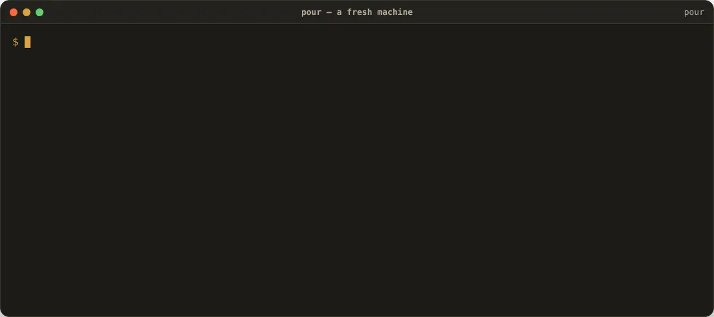
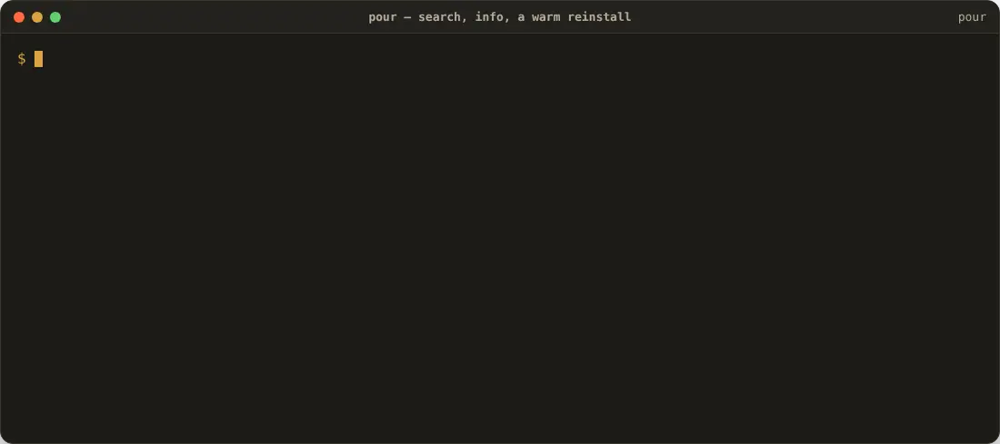
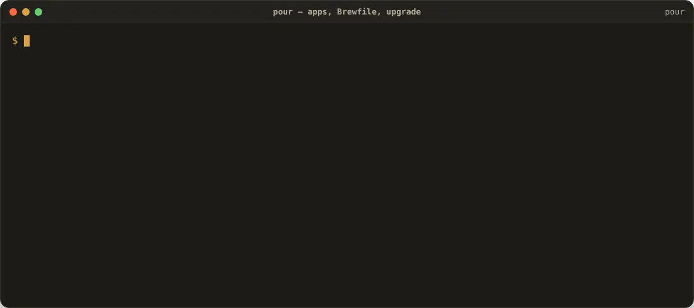
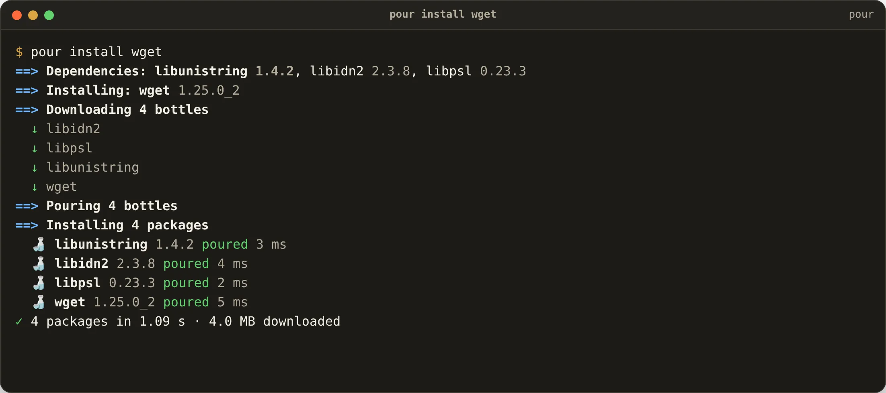
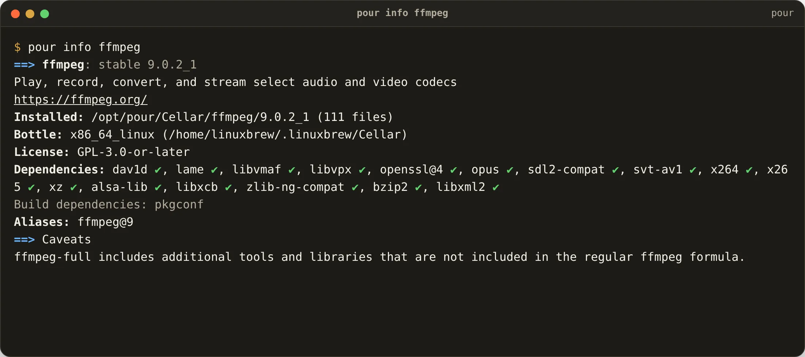
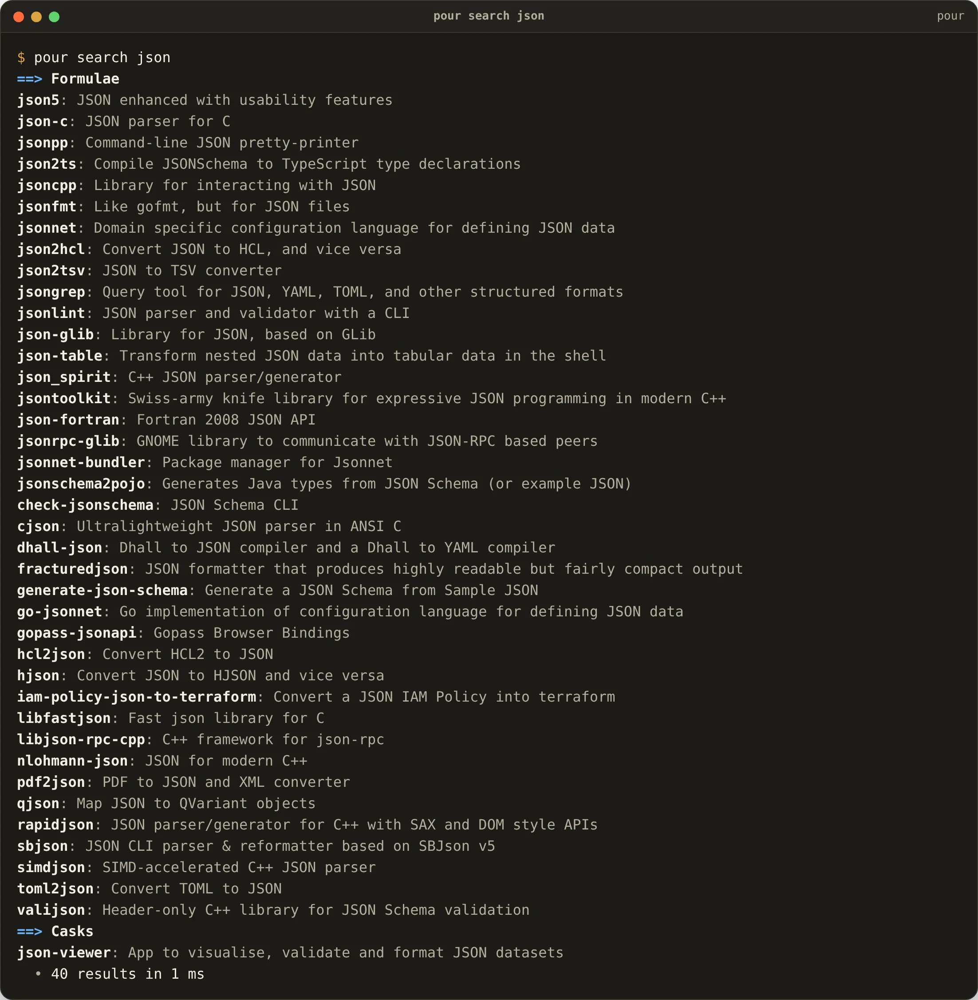
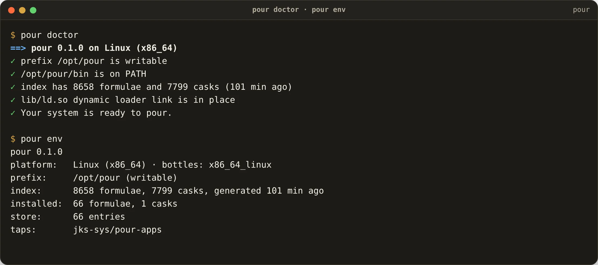

<p align="center">
  <picture>
    <source media="(prefers-color-scheme: dark)" srcset="docs/pour-dark.svg">
    
  </picture>
</p>

<h1 align="center">Pour</h1>

<p align="center"><strong>The Homebrew-compatible package manager that installs in milliseconds.</strong><br>
Every Homebrew formula and cask, poured into <code>/opt/pour</code> by a 3 MB Rust binary.<br>
macOS · Linux · WSL · ChromeOS · Windows · FreeBSD · Haiku · iOS</p>

<p align="center">
  <a href="https://ipconfig.co.network/pour">ipconfig.co.network/pour</a> ·
  <a href="https://github.com/JKS-sys/pour-13-Oct-2026/releases/latest">Downloads</a> ·
  <a href="https://github.com/JKS-sys/pour-registry-13-Oct-2026">Registry</a> ·
  <a href="https://github.com/JKS-sys/pour-apps-13-Oct-2026">Apps</a> ·
  <a href="https://github.com/JKS-sys/pour-bench-13-Oct-2026">Benchmarks</a>
</p>

```sh
curl -fsSL https://ipconfig.co.network/pour/install | sh
```

> ⭐ **If Pour saves you time, star this repository** — stars are how other people find it.

<!-- stats:start -->
| | |
|---|---|
| Formulae registered | **8,658** |
| Casks registered | **7,784** |
| The creator's apps | **15** |
| `pour info jq` | **9 ms** (Homebrew: 601 ms, 65× slower) |
| `pour search json` | **8 ms** (Homebrew: 794 ms, 106× slower) |
| Warm `pour install jq` | **6 ms** (Homebrew: 5.3 s, 888× slower) |
| Cold `pour install ffmpeg` | **8.1 s** (Homebrew: 193.2 s, 24× slower) |
| Measured | [pour-bench](https://github.com/JKS-sys/pour-bench-13-Oct-2026), 2026-10-13, same Linux machine, same packages, both tools from a clean state |
<!-- stats:end -->

## See it move

Every clip below is a recording of the real `pour`, with sound. Click a WebP's caption for the MP4 with audio.

### Install Pour, then pour `ffmpeg` and its 56 dependencies

A fresh machine. The installer verifies the download against the release feed, creates `/opt/pour`, fetches the index of 16,000 packages, and `pour install ffmpeg` downloads every bottle at once, relocates them in parallel and links them — all of it in seconds.



[▶ Watch with sound (MP4)](docs/demo-install.mp4)

### Search, info and a warm reinstall

`pour search` and `pour info` answer from a memory-mapped index in a few milliseconds, process start included, where Homebrew boots Ruby for over half a second. A package that has been poured before comes back from the store in single-digit milliseconds — no download, no unpacking.



[▶ Watch with sound (MP4)](docs/demo-search.mp4)

### Apps, Brewfiles and upgrades

Pour installs the creator's own apps on macOS, Windows, Linux and FreeBSD through a second registry, reads the Brewfile you already have, and upgrades everything that is outdated in one go.



[▶ Watch with sound (MP4)](docs/demo-apps.mp4)

**Remove Pour** (packages, store, index, the PATH lines and the link; apps it placed in /Applications stay):

```sh
curl -fsSL https://ipconfig.co.network/pour/uninstall | sh
```

## Screenshots

<table>
<tr>
<td><br><sub>`pour install wget`: dependencies first, every bottle downloaded in parallel, each package poured in milliseconds.</sub></td>
<td><br><sub>`pour info`: version, bottle for this machine, licence, dependencies with a tick for the ones already installed.</sub></td>
</tr>
<tr>
<td><br><sub>`pour search`: ranked by name, then description; formulae and casks apart; installed ones ticked.</sub></td>
<td><br><sub>`pour doctor` and `pour env`: prefix, PATH, index age, dangling links, loader setup on Linux.</sub></td>
</tr>
</table>

## Why Pour

Homebrew's front door is slow: every command boots a Ruby interpreter, evaluates formulae, shells out to `install_name_tool` for each binary and re-signs them one by one. Pour keeps the farm and replaces the door.

| | Homebrew | Pour |
|---|---|---|
| Written in | Ruby (+ Bash) | Rust, one static binary (2.6–3.3 MB) |
| `info` / `search` | boots Ruby, 0.6–0.8 s | memory-mapped index, 5–10 ms including process start |
| Downloads | sequential, cached | all bottles at once, SHA-256 while streaming |
| Relocation | `install_name_tool` + `codesign` per file | in process, in parallel, one re-sign per file |
| Reinstall / second machine | unpack again | content-addressed store: APFS clone or symlink |
| Post-install steps | Ruby, sequential | native, in parallel after each package's dependencies |
| Prefix | `/opt/homebrew`, `/usr/local`, `/home/linuxbrew/.linuxbrew` | `/opt/pour` everywhere — shorter on purpose, so every rewritten path fits in place |
| Systems | macOS, Linux, WSL | macOS, Linux, WSL, ChromeOS, plus Windows, FreeBSD, Haiku and iOS for search, info and Pour-native apps |

Measured numbers, cold and warm, brew and pour on the same machine: [pour-bench](https://github.com/JKS-sys/pour-bench-13-Oct-2026). Cold installs are bound by your connection; warm ones are where the architecture shows.

## Install

**macOS (Apple Silicon and Intel), Linux (x86_64, arm64), WSL, the ChromeOS Linux container, iSH on iOS:**

```sh
curl -fsSL https://ipconfig.co.network/pour/install | sh
```

The script explains each step, checks the SHA-256 of what it downloads, asks for your password once to create `/opt/pour`, fetches the index and adds one line to your shell profile. Set `POUR_NO_MODIFY_PATH=1` to keep your profile untouched.

**Windows 10/11:** download [`pour-windows-x86_64.exe`](https://github.com/JKS-sys/pour-13-Oct-2026/releases/latest) (or `arm64`), put it on your `PATH` as `pour.exe`, run `pour init`. Pour on Windows searches the registry, shows package info and installs the Pour-native apps; Homebrew bottles need WSL, where the one-line installer works as on Linux.

**FreeBSD 14:** [`pour-freebsd-x86_64`](https://github.com/JKS-sys/pour-13-Oct-2026/releases/latest) → `/usr/local/bin/pour`, then `pour init`. Homebrew publishes no FreeBSD bottles, so Pour gives you the registry, `info`, `search` and the apps that ship a FreeBSD build.

**Haiku:** `pkgman install rust_bin` (or `cargo`) then `cargo install --git https://github.com/JKS-sys/pour-13-Oct-2026 pour`. Pour's prefix on Haiku is `~/config/non-packaged/pour`.

**Any system, from source:** `cargo install --git https://github.com/JKS-sys/pour-13-Oct-2026 pour` (Rust 1.86+).

**In CI:** `uses: JKS-sys/pour-action-13-Oct-2026@v1` with `packages: jq ffmpeg`.

Every release ships `SHA256SUMS`, and [`/pour/releases/latest.json`](https://ipconfig.co.network/pour/releases/latest.json) carries each file's digest.

## Storage

Pour keeps as little as it can. Its own files: a 2.4–3.2 MB binary, a 2.3 MB lean index (names, versions, descriptions, dependencies — memory-mapped, so `search`, `info` and `outdated` answer in a few milliseconds) and 3.5 MB of full package records split into 512 small compressed buckets, of which a command inflates only the ones it needs. Both are trimmed to your machine's bottle tags and macOS versions at every `pour update`. Packages are unpacked once into the store; kegs are APFS clones on macOS and symlinks on Linux, so nothing sits on disk twice, and the downloaded bottle is deleted as soon as it is in the store (`POUR_KEEP_DOWNLOADS=1` keeps it). `pour env` prints the exact figures; `pour cleanup` removes store entries nothing uses any more.

## Use

```sh
pour install ffmpeg wget            # command-line tools: formulae and their dependencies
pour install gh rclone yt-dlp       # on Windows and FreeBSD too: each tool's own build where no bottle exists
pour install --cask firefox         # apps
pour install --cask peek keel       # the creator's apps (macOS, Windows, Linux, FreeBSD)
pour search image viewer            # names and descriptions, ranked
pour info python                    # everything about a package (--json for scripts)
pour upgrade                        # all outdated formulae and casks
pour uninstall --zap firefox        # remove an app with its preferences and caches
pour bundle                         # install from the Brewfile in this directory
pour list                           # Pour's packages, then what Homebrew installed here and how much of it Pour has
pour migrate                        # install everything Homebrew has on this machine (brew need not be on PATH)
pour register mytool --cli …        # register an app or a tool: checked automatically, listed at once
pour list · outdated · leaves · deps ffmpeg --tree · uses openssl@3
pour apps · register · link · unlink · pin · unpin · tap add · doctor · cleanup · env · self-update
```

Shell completions: `pour completions zsh > ~/.zfunc/_pour` (bash, fish, elvish and PowerShell too).

## How a bottle is poured

1. **Plan.** The index resolves names (aliases and old names included) and walks run-time dependencies for your system; on Linux the `uses_from_macos` libraries that macOS provides are added.
2. **Fetch.** Bottles come from `ghcr.io/homebrew/core`, in parallel, verified by SHA-256 as they stream; the bottle manifest's `sh.brew.tab` says which files carry placeholders.
3. **Pour.** Each bottle is unpacked once into `store/<sha256>` and relocated there: `@@HOMEBREW_PREFIX@@` placeholders and Homebrew's build prefix are rewritten in text files, in Mach-O load commands (then re-signed once per file) and in ELF interpreters and rpaths. Pour's prefix is never longer than Homebrew's, so every rewrite fits in place and no header has to grow.
4. **Place.** The keg appears in `Cellar/<name>/<version>` as an APFS clone on macOS or a symlink into the store on Linux, is linked into the prefix with Homebrew's own rules (whole directories where nothing shares them, per-file where they do), and gets a receipt — plus a Homebrew-style `INSTALL_RECEIPT.json` so tools that read cellars still understand it.
5. **Finish.** Homebrew's declarative post-install steps run natively, each on its own thread after the steps of its dependencies.

```text
/opt/pour/
  bin lib include share etc opt   links into kegs
  Cellar/<name>/<version>/        kegs
  Caskroom/<token>/<version>/     app receipts
  store/<sha256>/                 unpacked, relocated bottles (shared, reused)
  cache/downloads/                bottles and app downloads
  var/pour/index.pour             the index · taps/ extra registries
```

Environment: `POUR_PREFIX` (13 characters or fewer on macOS), `POUR_CACHE`, `POUR_INDEX_URL`, `POUR_CA_BUNDLE`/`SSL_CERT_FILE` for TLS-inspecting proxies, `HTTPS_PROXY`, `POUR_SOUND=0`, `POUR_ANIMATIONS=0`, `NO_COLOR`, `FORCE_COLOR`.

### Colour, motion and sound

Every kind of thing has its own colour, so a glance tells them apart — and there is no pink or magenta anywhere (a test checks every hue stays outside 280–350°):

| | colour | | colour |
|---|---|---|---|
| formulae | teal | apps (casks) | gold |
| tools with their own builds | lime | versions and numbers | cyan |
| old → new version | red → green | paths | sky |
| links | blue | registries (taps) | violet |
| Homebrew's packages | amber | section headings | a hue each, in order |
| JSON keys · strings · numbers · true/false · null | blue · green · cyan · orange · red | brackets | by depth: gold, cyan, lime, violet, orange, sky |

`--json` is coloured on a terminal and in CI logs, plain in pipes. A finished install plays a short pouring animation (a bottle tips, the glass fills); progress bars are gold on slate with green byte counts and sky speeds. Each command ends with its own system sound in an interactive terminal — install *Glass*, upgrade *Hero*, uninstall *Bottle*, update *Pop*, search *Tink* (quiet), cleanup *Purr*, register *Submarine*, an error *Basso* on macOS; matching freedesktop sounds on Linux and Windows' own sounds on Windows. Nothing plays in pipes, CI, `--quiet` or `--json`.

In CI (GitHub Actions, GitLab, Buildkite, Azure Pipelines, CircleCI) Pour turns its colours on by itself; [pour-action](https://github.com/JKS-sys/pour-action-13-Oct-2026) adds a banner, one collapsible group per step, a timing for every package and a job summary with bars and a chart of where the time went. CI machines have no speakers, so the sounds stay on your desktop.

## Registries

The [Pour registry](https://github.com/JKS-sys/pour-registry-13-Oct-2026) re-indexes Homebrew's formulae and casks every four hours from Homebrew's public API and logs what it registered and de-registered. [pour-apps](https://github.com/JKS-sys/pour-apps-13-Oct-2026) registers the creator's own applications with their live release feeds, and **pour-tools** — 125 command-line tools (gh, rclone, yt-dlp, ffmpeg, git, cmake, ninja, caddy, cloudflared, ripgrep, uv, deno, bun…) with their own builds for macOS, Linux (x86_64, arm64, i686), Windows (x86_64, arm64) and FreeBSD, about 800 downloads in all, each with its SHA-256. A tool is listed only when it qualifies — a stable release, a licence, a checksum for every download, at least two systems — and the list is rebuilt every six hours. Their names are Homebrew's names, so `pour install gh` is the same command everywhere: Homebrew's bottle where one exists, the tool's own build where not. Any JSON file in Homebrew's API shape is a registry: `pour tap add you/apps https://example.com/index.json`.

### Register your own app or tool

```sh
pour register fancy --desc "A fancy app for fancy people" --homepage https://fancy.example \
     --feed https://fancy.example/latest.json                       # an app: pour install --cask fancy
pour register tl --cli --desc "Does one useful thing very fast" --homepage https://tl.example \
     --version 2.0.1 --bin tl \
     --url linux-x86_64=https://tl.example/tl-linux.tar.gz#<sha256> \
     --url windows-x86_64=https://tl.example/tl-win.zip#<sha256>     # a tool: pour install tl
```

No one approves anything by hand. The registry checks it on the spot — an id nobody else has (not a Homebrew formula or cask, not an existing app or tool), a one-line description, an https page that answers, downloads that answer with a real file under 2 GB and carry their SHA-256 (or come from a release feed), plain program names — and lists it within a minute when it qualifies, or answers with every reason it does not. The first registration prints a key; it is needed to update the entry later. The same JSON can be POSTed to `https://ipconfig.co.network/pour/api/register`; `/pour/api/registrations` lists everything registered. Apps made with the ship stack register themselves at every release, and an app that pings the dashboard for the first time is listed as soon as its release feed answers.

## Repositories

| | |
|---|---|
| [pour](https://github.com/JKS-sys/pour-13-Oct-2026) | the package manager (this repo): `pour-core` library, `pour` CLI, `install.sh`, `update.sh` |
| [pour-registry](https://github.com/JKS-sys/pour-registry-13-Oct-2026) | the index of every Homebrew formula and cask, synced every four hours |
| [pour-apps](https://github.com/JKS-sys/pour-apps-13-Oct-2026) | the creator's apps, registered for macOS, Windows, Linux and FreeBSD |
| [pour-site](https://github.com/JKS-sys/pour-site-13-Oct-2026) | the website and mirror at ipconfig.co.network/pour (Cloudflare Worker) |
| [pour-action](https://github.com/JKS-sys/pour-action-13-Oct-2026) | GitHub Action: `uses: JKS-sys/pour-action-13-Oct-2026@v1` |
| [pour-bench](https://github.com/JKS-sys/pour-bench-13-Oct-2026) | reproducible Pour-vs-Homebrew timings |

## Build and release

```sh
cargo test                      # 54 unit tests + the CLI
cargo build --release -p pour   # target/release/pour
bash update.sh                  # the one script: tests, every platform (zig cross-builds), release,
                                # R2 mirror, registry sync, apps, site deploy, repo details
```

`update.sh --no-publish` builds `dist/` for all eight targets without touching GitHub or Cloudflare.

## Pour and Homebrew

Pour is a client for the Homebrew ecosystem. It installs the bottles Homebrew's build farm compiles, tests and publishes, and reads Homebrew's public JSON API to know about them. It does not build from source and it never writes to `/opt/homebrew`; both can live on one machine. `pour list` shows what Homebrew installed (read from its Cellar and Caskroom) with how much of it Pour has, and `pour migrate` installs it with Pour. Pour is not affiliated with Homebrew.

## The apps, and new ones

```sh
pour apps                         # every app made at ipconfig.co.network — new ones, too
pour install --cask hone          # any of them, from its live release feed
pour register tilt --feed https://ipconfig.co.network/updates/tilt/latest.json --desc "…" --homepage …
```

A new app is listed by itself: when it registers (at release, from the ship stack's `update.sh`), or when it pings the dashboard for the first time and its release feed answers with a version and a download. Then `pour update && pour install --cask <app>` works on every computer.

<!-- licence -->
## Licence

Copyright © 2026 **Jagadeesh Kumar S**. All rights reserved. Pour is source-available: you may use it freely on your own computers and read its source; copying, redistribution and derived works need written permission. See [LICENSE](LICENSE). Third-party crates keep their own licences, listed in [THIRD-PARTY-NOTICES.txt](THIRD-PARTY-NOTICES.txt).
<!-- /licence -->

## The creator

**Jagadeesh Kumar S** is a creator in Velachery, Chennai — nine years of full-stack work (React, Node.js, MongoDB), 4K video, YouTube thumbnails and a shelf of desktop apps, with a news show, [NewsCraft World Report](https://www.youtube.com/@JKS-sys), on the side. [About](https://ipconfig.co.network/about) · [Sponsor](https://ipconfig.co.network/sponsor) · JKS.sys@icloud.com
